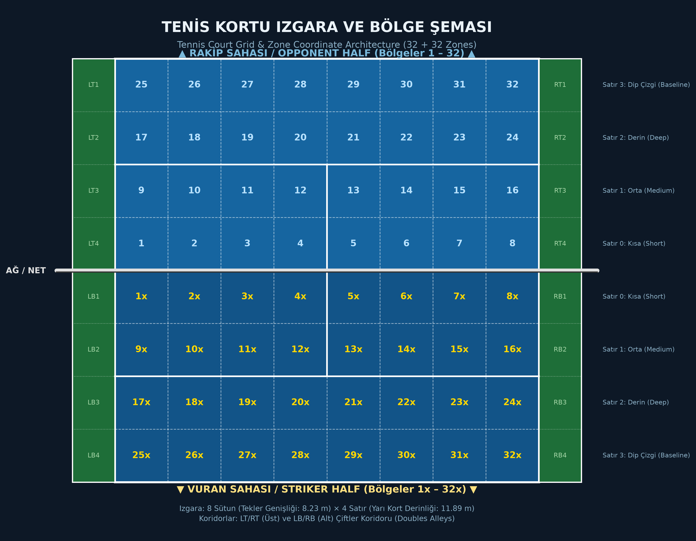
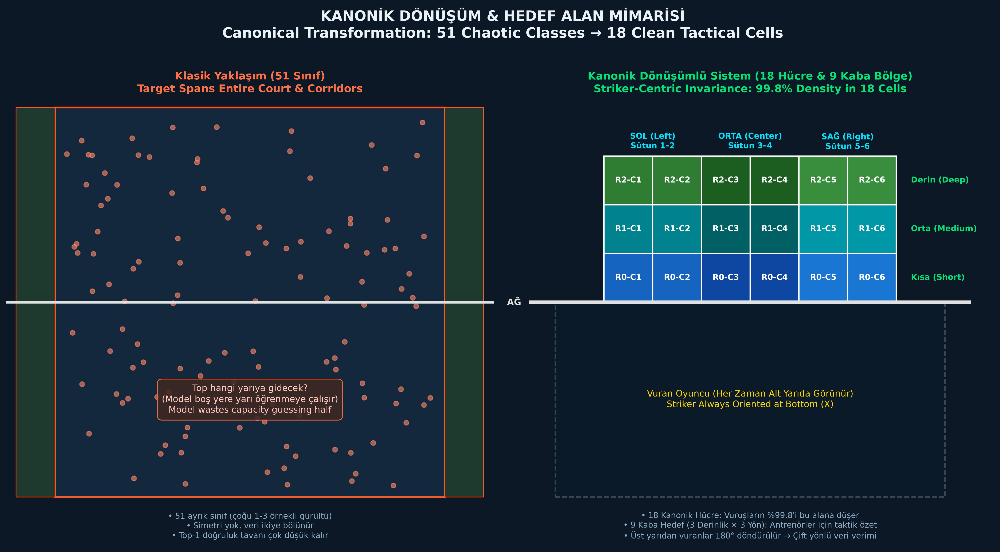
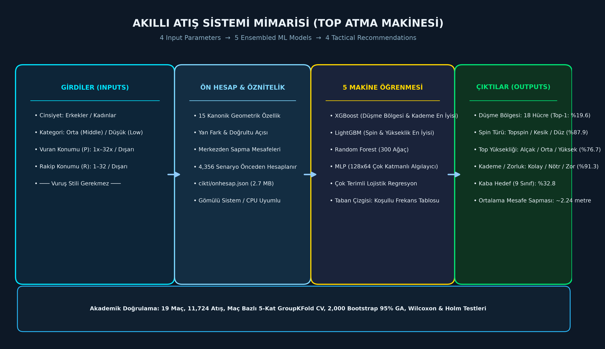
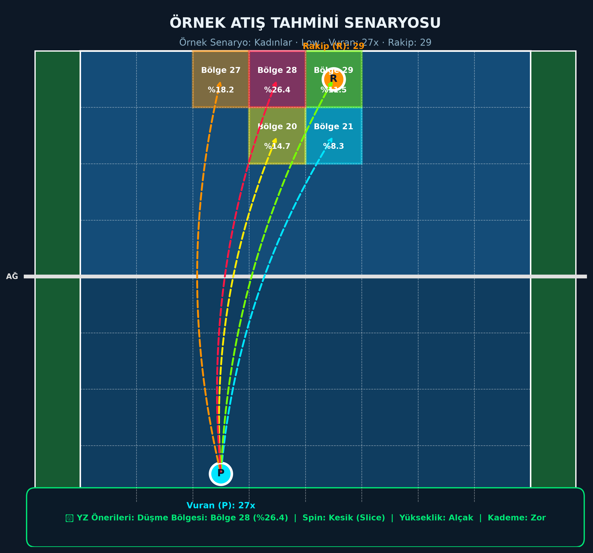
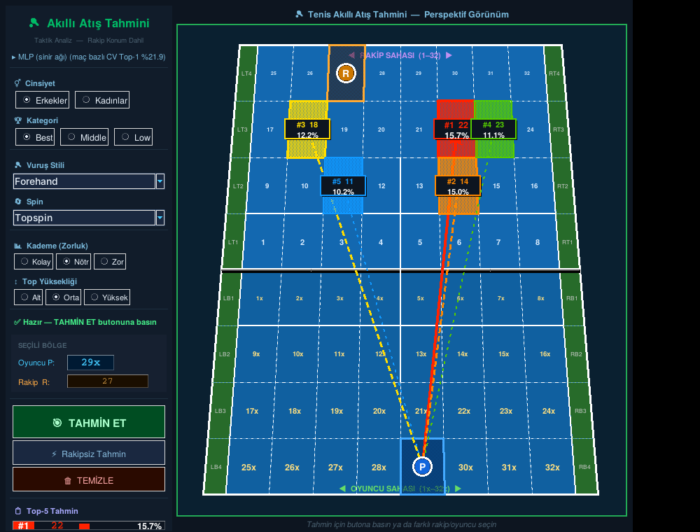
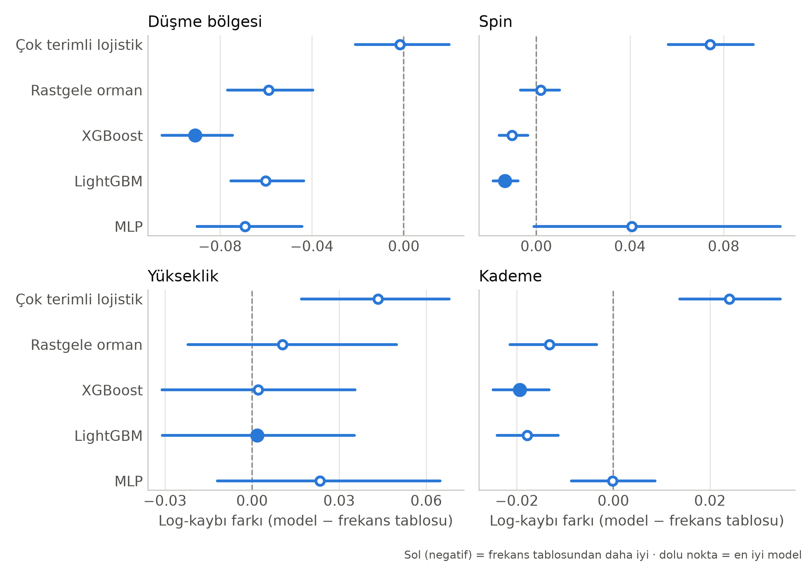
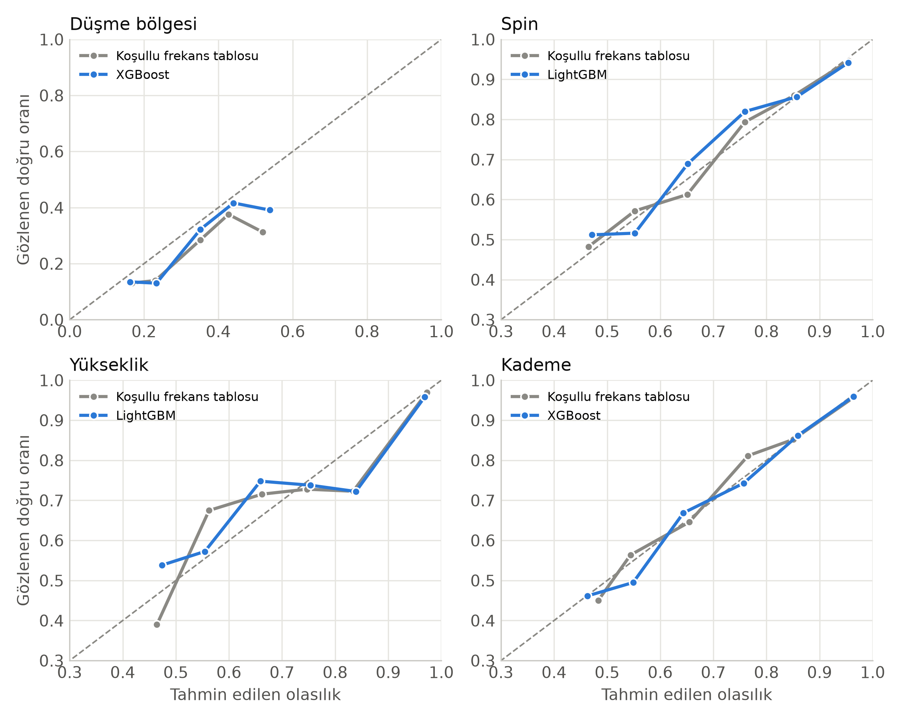

# 🎾 Tenis Yapay Zeka & Akıllı Atış Sistemi (Tennis AI & Smart Ball Machine)

[](https://www.python.org/downloads/)
[](https://opensource.org/licenses/MIT)
[](https://scikit-learn.org/)
[](https://xgboost.readthedocs.io/)
[](https://lightgbm.readthedocs.io/)

[📖 Read English Documentation (README_EN.md)](README_EN.md)

---

## 📌 Proje Özeti (Executive Summary)

Bu proje; profesyonel tenis maçlarındaki taktiksel vuruş örüntülerini analiz eden, **oyuncu ve rakip konumlarından topun nereye, hangi spinle, hangi yükseklikle ve hangi zorlukta düşeceğini tahmin eden** yeni nesil bir **Akıllı Atış ve Top Atma Makinesi Yapay Zeka Sistemi**dir.

Sistem, 19 profesyonel maçtan elde edilen **11.724 başarılı vuruş** verisi üzerinde geliştirilmiş; veri sızıntılarını önleyen **maç bazlı 5-kat çapraz doğrulama (GroupKFold)**, **kanonik bakış açısı dönüşümü (vuran merkezli kort rotasyonu)** ve **5 makine öğrenmesi modeli (XGBoost, LightGBM, Random Forest, MLP Sinir Ağı, Lojistik Regresyon)** ile kapsamlı akademik karşılaştırmalara tabi tutulmuştur.

Ayrıca antrenman kortlarında ve gömülü sistemlerde (Raspberry Pi, mini PC vb.) anında tepki verebilmesi için **4.356 olası durum önceden hesaplanmış (onhesap.json - 2.7 MB)**; scikit-learn veya GPU gerektirmeyen, **0.01 saniyede yanıt veren** interaktif bir masaüstü arayüzü (`gui_atis.py`) ve konsol arayüzü (`05_konsol_tahmin.py`) geliştirilmiştir.

---

## 📑 İçindekiler
1. [Saha Mimarisi ve Görseller](#-saha-mimarisi-ve-görseller)
2. [Sistemin Temel Mantığı ve Bilimsel Yenilikler](#-sistemin-temel-mantığı-ve-bilimsel-yenilikler)
3. [Akıllı Atış Modeli: 4 Girdi → 4 Çıktı](#-akıllı-atış-modeli-4-girdi--4-çıktı)
4. [Tüm Python Dosyalarının Detaylı İncelemesi](#-tüm-python-dosyalarının-detaylı-i̇ncelemesi)
5. [Karşılaştırmalı Model Başarı Tabloları (Sonuçlar)](#-karşılaştırmalı-model-başarı-tabloları-sonuçlar)
6. [Önhesaplama Motoru (Precomputation Engine)](#-önhesaplama-motoru-precomputation-engine)
7. [Kurulum ve Çalıştırma Kılavuzu](#-kurulum-ve-çalıştırma-kılavuzu)
8. [Canlı Konsol Komutları ve Kullanım](#-canlı-konsol-komutları-ve-kullanım)
9. [Proje Desteği ve Atıf](#-proje-desteği-ve-atıf)

---

## 🏟 Saha Mimarisi ve Görseller

Projede tenis kortu, standart 8.23 m tekler genişliği ve 11.89 m yarı kort derinliği üzerinden ızgara sistemine bölünmüştür.

### 1. Tenis Kortu Izgara ve Bölge Şeması (32 + 32 Bölge ve Çiftler Koridoru)
* **Üst Yarı (Rakip Sahası):** `1` ile `32` arasındaki bölgeler (8 sütun × 4 satır).
* **Alt Yarı (Vuran Sahası):** `1x` ile `32x` arasındaki bölgeler (8 sütun × 4 satır).
* **Çiftler Koridorları:** Sol üst/sağ üst (`LT1-4`, `RT1-4`) ve sol alt/sağ alt (`LB1-4`, `RB1-4`).



---

### 2. Kanonik Dönüşüm Şeması: 51 Kaotik Sınıftan 18 Kanonik Hücreye
Geleneksel tenis modellerinde topun kortun hangi yarısına gittiği 51 serbest bölge olarak ele alınır. Bu durum modelin kapasitesini "top hangi yarıya düşecek" sorusuna harcamasına yol açar.

Projemizde geliştirilen **Vuran Merkezli Kanonik Dönüşüm** sayesinde:
* Eğer vuruş üst yarıdan yapılmışsa kort 180° döndürülür.
* Vuran oyuncu daima alt yarıda, hedef ise daima karşı yarıda modellenir.
* Başarılı vuruşların **%99,8'inin düştüğü 18 hücre** (3 Derinlik × 6 Sütun) ana hedef haline getirilir.
* Antrenörler için taktiksel 9 kaba hedef (Derinlik: Kısa/Orta/Derin × Yön: Sol/Orta/Sağ) türetilir.



---

### 3. Akıllı Atış Sistemi Mimarisi (Top Atma Makinesi)
Top atma makinesi başındaki bir tenisçi veya antrenör, vuruş anında hangi stilde vuruş yapacağını önceden bilemez. Bu nedenle **vuruş stili girdi olmaktan çıkarılmış**, yalnızca bağlam değişkenleri (4 girdi) ile 4 taktik öneri üreten uçtan uca mimari kurulmuştur.



---

### 4. Örnek Taktik Atış Tahmini Senaryosu
Aşağıdaki görselde, Kadınlar kategorisinde vuran oyuncunun `27x` (deuce dip köşe), rakibin `29` bölgesinde olduğu bir senaryoda modelin ürettiği ilk 5 düşme bölgesi olasılığı ve atış parametreleri gösterilmektedir:



---

### 5. Grafiksel Kullanıcı Arayüzü (GUI Ekran Görüntüsü)
Masaüstü uygulaması (`gui_atis.py`), Australian Open hardcourt renk paleti ve 3D perspektif kort projeksiyonu sunar:



---

## 🧠 Sistemin Temel Mantığı ve Bilimsel Yenilikler

1. **Maç Bazlı Çapraz Doğrulama (`GroupKFold`):**
   * Atış bazlı rastgele bölmede aynı rallinin veya maçın birbirini takip eden atışları hem eğitim hem test setine sızar (data leakage). Bu durum yapay olarak yüksek doğruluk üretir.
   * Projemizde 19 maçın her biri bağımsız bir grup olarak tanımlanmıştır. Test katındaki hiçbir maçın vuruşu eğitimde görülmez.
2. **Gelecek Bilgisinin ve Sonuç Değişkenlerinin Ayıklanması:**
   * Atıştan sonra ölçülen değişkenler (`top_hizi`, `top_mesafe_metre`, `top_ucus_suresi`, `frame_farklari`) ve rakibin bir sonraki temas noktası olan `bulusulan_bolge` modelden titizlikle çıkarılmıştır.
3. **Kanonik Geometri ve Bağıl Açı:**
   * Oyuncuların salt kort koordinatları yerine, vuran ve rakip arasındaki enine mesafe farkı (`yan_fark`) ve vuruş açısı (`aci_derece`) türetilmiştir.

---

## 🎯 Akıllı Atış Modeli: 4 Girdi → 4 Çıktı

| Bileşen | Tanım | Değerler |
|---|---|---|
| **Girdi 1** | Cinsiyet | Erkekler, Kadınlar |
| **Girdi 2** | Seviye / Kategori | Orta (Middle), Düşük (Low) *(Best eğitimde kullanılır)* |
| **Girdi 3** | Vuran Konumu (P) | Alt yarı: `1x` – `32x` veya Kort Dışı |
| **Girdi 4** | Rakip Konumu (R) | Üst yarı: `1` – `32` veya Kort Dışı (Bilinmiyor) |
| **Çıktı 1** | **Düşme Bölgesi** | 18 Kanonik Hücre (veya 9 Kaba Taktik Bölge) |
| **Çıktı 2** | **Spin Türü** | Topspin (Öne dalar), Kesik / Slice (Süzülür, yavaşlar), Düz / Flat |
| **Çıktı 3** | **Top Yüksekliği** | Alçak (1), Orta (2), Yüksek (3) |
| **Çıktı 4** | **Kademe (Zorluk)** | Kolay (1), Nötr (2), Zor (3) |

---

## 📂 Tüm Python Dosyalarının Detaylı İncelemesi

Proje modüler, temiz kod prensiplerine uygun ve tek sorumluluk prensibiyle (SRP) yapılandırılmıştır:

### 1. `tenis/ayarlar.py` (Sistem Sabitleri ve Yapılandırma)
* Tüm sihirli sayıların (magic numbers) tek yerde toplandığı modüldür.
* Kort ebatları (8 sütun, 4 satır, 8.23m tekler eni, 11.89m boy), rastgele tohum (`RASTGELE = 42`), 5-kat CV parametresi tanımlıdır.
* 24 ham vuruş stili 7 taktiksel aileye indirgenir (`Forehand`, `Backhand`, `Slice`, `Vole`, `Servis`, `Smaç`, `Diğer`).
* Spin türleri 3 fiziksel gruba ayrılır (`Topspin`, `Kesik`, `Düz`).
* Modelden dışlanan sızıntı sütunları sözlüğü burada tutulur.

### 2. `tenis/bolgeler.py` (Kort Geometrisi ve Kanonik Koordinat Dönüşümü)
* Kort üzerindeki tüm bölgelerin çözümlenmesinden (`coz`), string formatından satır-sütun ayrıştırmasından sorumludur.
* `kanonik(ad, vuran_yari)` fonksiyonu ile vuran oyuncu üst yarıdaysa kortu 180° döndürür.
* Kanonik hücrelerden gerçek kort bölgesine geri dönüşüm (`kanonikten_ada`) sağlar.
* Normalize merkez koordinatları (`merkez_norm`) ve iki hedef hücre arasındaki yaklaşık metre cinsinden Öklid mesafesini (`mesafe_metre`) hesaplar.

### 3. `tenis/veri.py` (Veritabanı Erişimi ve Veri Temizliği)
* SQLite veritabanından (`veri/veritabani2.db`) başarılı vuruş kayıtlarını çeker.
* Vuranın hangi yarıda olduğunu **yalnızca atış öncesi bilgiden** (`vurulan_bolge` veya `nereden_geldi`) saptar.
* Geçersiz veya tanımsız hedefleri ayıklar ve temizlenmiş analitik veri çerçevesini raporla birlikte sunar.

### 4. `tenis/ozellikler.py` (Öznitelik Çıkarım Motoru)
* **Eğitim ve tahmin aşamalarında birebir aynı fonksiyonun kullanılmasını garanti eder.**
* Oyuncu ve rakip için satır, sütun, kort dışılık bayrağı, merkez çizgisine uzaklık değerlerini çıkarır.
* Oyuncular arası göreli geometriyi (`yan_fark` ve `aci_derece`) trigonometrik olarak hesaplar.
* Kategorik değişkenleri one-hot formatına dönüştürür.

### 5. `tenis/modeller.py` (Makine Öğrenmesi Modelleri Kayıt Defteri)
* 7 farklı model mimarisini standart `fit` ve `predict_proba` arayüzüyle sunar:
  * **Çoğunluk Sınıfı (DummyClassifier):** En basit taban çizgisi.
  * **Koşullu Frekans Tablosu (`FrekansTablosu`):** Hiyerarşik geri çekilmeli (backoff) gerçek istatistiksel taban çizgisi ($P(\text{hedef} \mid \text{aile}, v, r) \to P(\text{hedef} \mid \text{aile}, v) \to \dots$).
  * **Lojistik Regresyon:** Standartlaştırılmış çok terimli lojistik regresyon.
  * **Random Forest:** 500 ağaçlı rastgele orman.
  * **XGBoost:** Histogram tabanlı, gradyan artırmalı ağaç modeli (400 ağaç).
  * **LightGBM:** Yaprak odaklı hızlı gradyan artırma modeli (400 ağaç).
  * **MLP:** 128 ve 64 nöronlu, erken durdurmalı (early stopping) yapay sinir ağı.
* `Hizala` sarmalayıcısı sayesinde katlar arasında eksik sınıf çıksa dahi olasılık matrislerinin 18 sınıfa tam oturmasını sağlar.

### 6. `tenis/metrikler.py` (Akademik Başarı Ölçütleri ve Hipotez Testleri)
* **Top-1 ve Top-3 Doğruluk:** En yüksek olasılıklı ilk 1 ve 3 tahminin başarısı.
* **Wilson Güven Aralığı:** Binom dağılımı için %95 güven aralıkları.
* **Kaba 9 Sınıf Doğruluğu:** Derinlik × Yön başarısı.
* **Mesafe Hatası:** Tahmin edilen bölge merkezi ile gerçek bölge arasındaki metre cinsinden ortalama sapma.
* **Çoklu Karşılaştırma Düzeltmesi (`holm`):** Holm-Bonferroni algoritması.
* **McNemar Testi:** İkili sınıflandırıcı hata matrislerinin kesin binom testiyle karşılaştırılması.
* **Maç Bazlı Wilcoxon İşaretli Sıralar Testi:** 19 maçın her birini bağımsız gözlem kabul ederek modellerin üstünlüğünü test eder.

### 7. `tenis/atis_modeli.py` (4 Girdi → 4 Çıktı Atış Sistemi Çekirdeği)
* Vuruş stilini girdi olmaktan çıkaran, 15 öznitelikli yeni girdi matrisini oluşturur.
* Düşme bölgesi (18 sınıf), Spin (3 sınıf), Yükseklik (3 sınıf) ve Kademe (3 sınıf) hedefleri için ayrı ayrı modelleri yapılandırır.
* Brier skoru ve dengeli doğruluk (balanced accuracy) metriklerini hesaplar.

### 8. `tenis/onhesap.py` (Önceden Hesaplanmış Tablo ve Komut Ayrıştırıcı)
* 4.356 senaryonun 5 model × 4 çıktı sonucunu tutan `cikti/onhesap.json` dosyasını okur.
* Bağımlılık gerektirmeyen saf Python standart kütüphanesiyle çalışır.
* Doğal dil komut ayrıştırıcısı (`komut_coz`) içerir: `kadin low 27x 29`, `rakip=31`, `model=mlp` gibi esnek girdileri canlı parametrelere dönüştürür.

### 9. `tenis/tahmin.py` (`TenisTahminci` Sınıfı)
* Eğitilmiş `model.joblib` dosyasını yükleyerek tekil veya toplu tahmin üreten nesne yönelimli sınıftır.
* GUI'nin beklediği koordinat ve olasılık sözlüklerini hazırlar.

### 10. `01_veri_raporu.py` (Veri Denetimi ve Keşifçi Analiz)
* Veritabanındaki vuruş ve maç dağılımlarını, spin tutarsızlıklarını, hedef hücre frekanslarını listeler ve `hedef_isi_haritasi.csv` dosyasını üretir.

### 11. `02_egit_degerlendir.py` (Klasik Model Eğitimi, Ablasyon ve Çapraz Doğrulama)
* 18 sınıflı klasik modeli 19 maç üzerinde 5-kat GroupKFold ile değerlendirir.
* Özellik grubu ablasyon analizi yaparak hangi özniteliğin ne kadar katkı sağladığını hesaplar.
* En iyi modeli seçerek `cikti/model.joblib` olarak kaydeder.

### 12. `03_tahmin_ornek.py` (Hızlı Çıkarım Örneği)
* Eğitilmiş model üzerinden konsola 4 örnek senaryo tahmini basar.

### 13. `04_atis_modeli_egit.py` (Atış Modelinin Eğitimi ve JSON Önhesabı)
* 4 çıktının her biri için 5 makine öğrenmesi modelini eğitir.
* Tüm 4.356 girdi kombinasyonunu hesaplayıp tamsayı ölçekleme ile `cikti/onhesap.json` dosyasına yazar.

### 14. `05_konsol_tahmin.py` (Etkileşimli CLI Tahmin Aracı)
* Grafik arayüz açmadan terminal üzerinden anlık tahmin sorgulama imkanı sunar.

### 15. `06_bes_model_karsilastirma.py` (Akademik Karşılaştırma ve Şekil Üretimi)
* 2.000 yinelemeli bootstrap ile %95 güven aralıklarını, beklenen kalibrasyon hatasını (ECE) ve Brier skorlarını hesaplar.
* Makale için Tablo 5, 6, 7 ve `sekil4_logkaybi_farki.png`, `sekil5_guvenirlik.png` görsellerini ve `karsilastirma_tablolari.xlsx` dosyasını oluşturur.

### 16. `gui.py` (Klasik Taktik Analiz Arayüzü)
* 24 vuruş stilini içeren eski mimariyi Tkinter canvas üzerinde Australian Open saha renkleriyle çizen görsel arayüz.

### 17. `gui_atis.py` (Top Atma Makinesi Canlı Masaüstü Arayüzü)
* Top atma makinesi için özel tasarlanmış arayüz.
* Arka planda terminal komutlarını dinleyen bir `threading.Thread` çalıştırır; fare tıklaması ile konsol komutları çift yönlü senkronizedir.

### 18. `generate_court_visuals.py` (Görsel Üretim Scripti)
* Matplotlib ve Pillow kullanarak yüksek çözünürlüklü saha şemalarını, kanonik dönüşüm diyagramlarını ve taktik çizimleri üreten yardımcı araçtır.

---

## 📊 Karşılaştırmalı Model Başarı Tabloları (Sonuçlar)

19 maç ve 11.724 atış üzerinde yapılan maç bazlı 5-kat çapraz doğrulama sonuçları:

### Tablo 5: Düşme Bölgesi Karşılaştırması (18 Sınıf)
| Model | Log-kaybı (%95 GA) | Brier | ECE | İlk-1 (%) | İlk-3 (%) | Kaba 9 Sınıf (%) | Ort. Hata (m) |
|---|---|---|---|---|---|---|---|
| **Çoğunluk Sınıfı** | 2.684 (2.647–2.721) | 0.901 | 0.000 | %9.9 | %27.9 | %18.0 | 2.98 |
| **Koşullu Frekans Tablosu** | 2.395 (2.365–2.427) | 0.842 | 0.052 | %18.6 | %47.8 | %31.0 | 2.39 |
| **Lojistik Regresyon** | 2.404 (2.378–2.431) | 0.841 | 0.038 | %18.3 | %47.7 | %30.4 | 2.38 |
| **Rastgele Orman (RF)** | 2.339 (2.316–2.361) | 0.830 | 0.043 | %18.8 | %49.4 | %31.4 | 2.34 |
| **XGBoost (En İyi)** | **2.304 (2.281–2.327)** | **0.824** | 0.036 | **%19.6** | **50.5%** | **%32.8** | **2.24** |
| **LightGBM** | 2.312 (2.289–2.336) | 0.825 | **0.024** | %19.5 | %50.4 | %32.7 | 2.26 |
| **MLP (Sinir Ağı)** | 2.347 (2.325–2.369) | 0.832 | 0.037 | %18.9 | %49.0 | %31.3 | 2.33 |

* XGBoost, log-kaybında frekans taban çizgisinden ve diğer modellerden **istatistiksel olarak anlamlı derecede daha üstündür** (Wilcoxon + Holm, $p < 0.001$, 19 maçın 19'unda daha iyi).

---

### Tablo 6: Spin, Top Yüksekliği ve Kademe (Zorluk) Karşılaştırması
| Çıktı | En İyi Model | En İyi Log-kaybı | Frekans Log-kaybı | En İyi İlk-1 | Frekans İlk-1 | İstatistiksel Anlamlılık |
|---|---|---|---|---|---|---|
| **Spin (3 Sınıf)** | LightGBM | **0.372** | 0.386 | **%87.9** | %87.5 | Anlamlı (17/19 maç, $p = 0.016$) |
| **Top Yüksekliği (3 Sınıf)** | LightGBM | **0.647** | 0.646 | **%76.7** | %76.7 | **Anlamlı Değil** ($p = 0.93$) |
| **Kademe / Zorluk (3 Sınıf)** | XGBoost | **0.266** | 0.285 | **%91.3** | %91.2 | Anlamlı (18/19 maç, $p = 0.002$) |

> **Önemli Bilimsel Not:** Top yüksekliğinde makine öğrenmesi modelleri basit koşullu frekans tablosunu geçememektedir. Spin ve kademedeki yüksek başarı ise modelin oyuncu konumlarından **servis anını** yakalamasından kaynaklanmaktadır.

---

### Makale Şekil 4 & Şekil 5 (Akademik Başarı Görselleri)

#### Şekil 4: Frekans Tablosuna Göre Eşleştirilmiş Log-Kaybı Farkı (%95 Bootstrap GA)


#### Şekil 5: Modellerin Güvenirlik ve Kalibrasyon Eğrileri


---

## ⚡ Önhesaplama Motoru (Precomputation Engine)

Akıllı top atma makineleri ve saha kenarı antrenör tabletleri kısıtlı donanımlara sahiptir. Modelin her tıklamada scikit-learn / XGBoost kütüphanelerini çağırıp çıkarım yapması yerine:
1. $2 \text{ Cinsiyet} \times 2 \text{ Kategori} \times 33 \text{ Vuran} \times 33 \text{ Rakip} = 4.356$ olası tüm senaryo üretilmiştir.
2. 5 modelin olasılıkları onbinde bir hassasiyetle tamsayı olarak saklanmıştır (`cikti/onhesap.json`, 2.7 MB).
3. Arayüz ve konsol araçları sıfır kütüphane bağımlılığıyla çalışır, bellek tüketimi 10 MB'ın altındadır.

---

## 🚀 Kurulum ve Çalıştırma Kılavuzu

### 1. Gereksinimlerin Kurulması
```bash
git clone https://github.com/purkusur-pixel/tenis-yapay-zeka.git
cd tenis-yapay-zeka
pip install -r requirements.txt
```

### 2. Arayüzün Başlatılması (Top Atma Makinesi Modu)
```bash
python gui_atis.py
```
* Doğrudan belirli bir senaryoyla başlatmak için:
```bash
python gui_atis.py Kadınlar Low 27x 29
```

### 3. Konsol Tahmin Aracının Çalıştırılması
```bash
python 05_konsol_tahmin.py kadin orta 20x 31
```
* Etkileşimli konsol modu için:
```bash
python 05_konsol_tahmin.py
```

### 4. Modelleri ve Karşılaştırma Raporlarını Sıfırdan Üretmek İçin
```bash
python 04_atis_modeli_egit.py          # 5 modeli eğitir ve onhesap.json'u üretir (~2 dk)
python 06_bes_model_karsilastirma.py  # Akademik tabloları ve şekilleri üretir (~2 dk)
```

---

## 💻 Canlı Konsol Komutları ve Kullanım

`gui_atis.py` açıkken terminale doğrudan komut yazabilirsiniz. Yapılan her seçim anında kort üzerine yansır:

```text
komut> kadin low 27x 29          # Tüm parametreleri tek satırda seç
komut> rakip=31                  # Sadece rakip konumunu değiştir
komut> vuran=disari              # Vuran oyuncu kort dışından vuruyor
komut> model=mlp                 # Modeli değiştir (lr, rf, xgb, lgbm, mlp, oto)
komut> durum                     # Mevcut seçim durumunu yazdır
komut> temizle                   # Seçimleri sıfırla
komut> yardim                    # Yardım metnini görüntüle
komut> cikis                     # Uygulamayı kapat
```

---

## 🏛 Proje Desteği ve Atıf

<p align="center">
  
  &nbsp;&nbsp;&nbsp;&nbsp;&nbsp;&nbsp;
  
</p>

<p align="center">
  <b>Trabzon Üniversitesi Spor Bilimleri Fakültesi</b><br />
  <b>Trabzon Üniversitesi Sporda Performans Değerlendirme ve Yetenek Seçimi Uygulama ve Araştırma Merkezi</b>
</p>

Bu çalışma, Türkiye Bilimsel ve Teknolojik Araştırma Kurumu (TÜBİTAK) tarafından 1001 Programı – Spor Araştırmaları kapsamında desteklenen 124M890 numaralı "Tenis için Yapay Zekâ Destekli Top Atma Makinesi Üretimi" başlıklı proje kapsamında gerçekleştirilmiştir.

This study was supported by the Scientific and Technological Research Council of Türkiye (TÜBİTAK) under the 1001 Programme – Sports Research (Project No: 124M890) within the scope of the project titled "Production of an Artificial Intelligence-Assisted Ball-Throwing Machine for Tennis".

**Proje Yürütücüsü:** Prof. Dr. Serdar Alemdağ  
**Yazılım Geliştirici:** Hüsnü Canbolat (husnucanbolat@trabzon.edu.tr)  
**Veri Kümesi:** 19 profesyonel tenis müsabakası, 11.724 başarılı vuruş.  
**Lisans:** MIT License — ayrıntılar için [LICENSE](LICENSE) dosyasına bakınız.

Bu çalışmayı akademik veya endüstriyel projelerinizde kullanırsanız lütfen depoya atıfta bulununuz.
