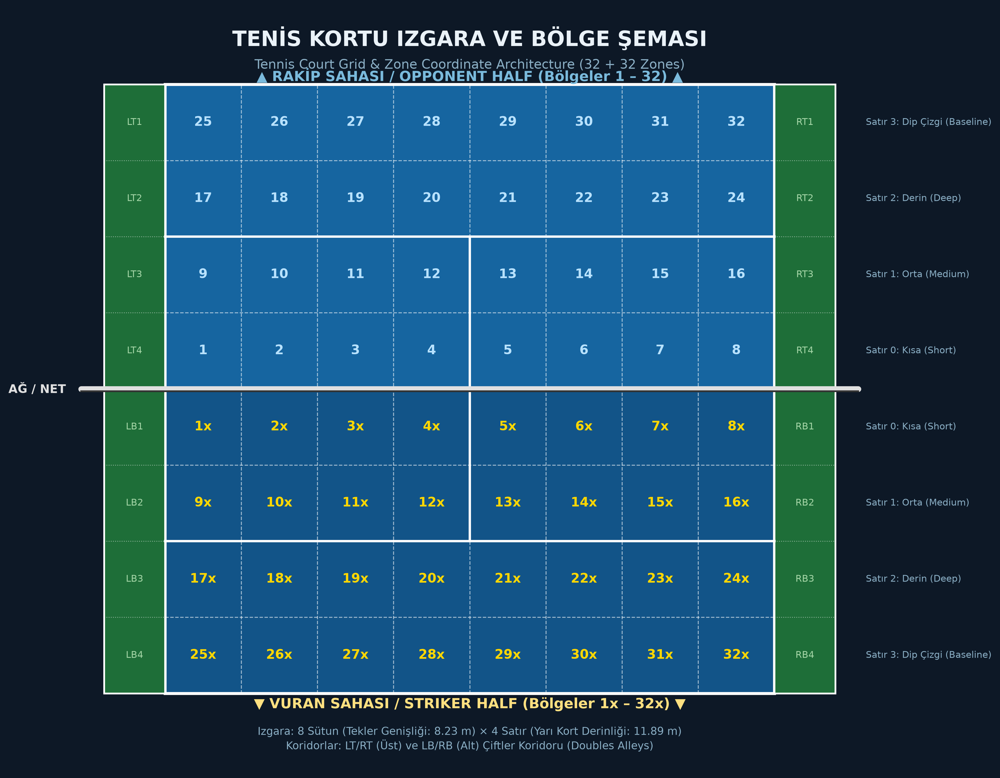
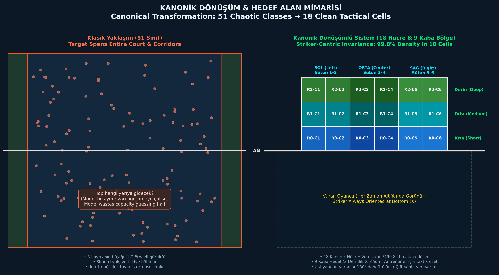
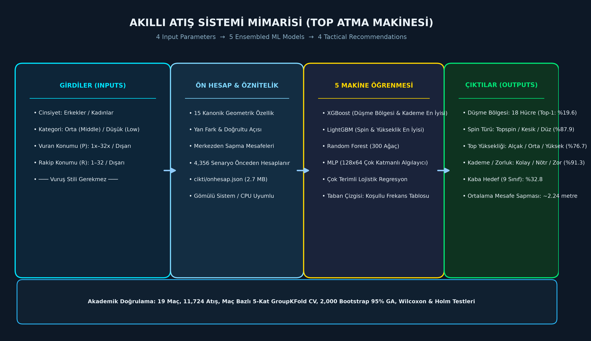
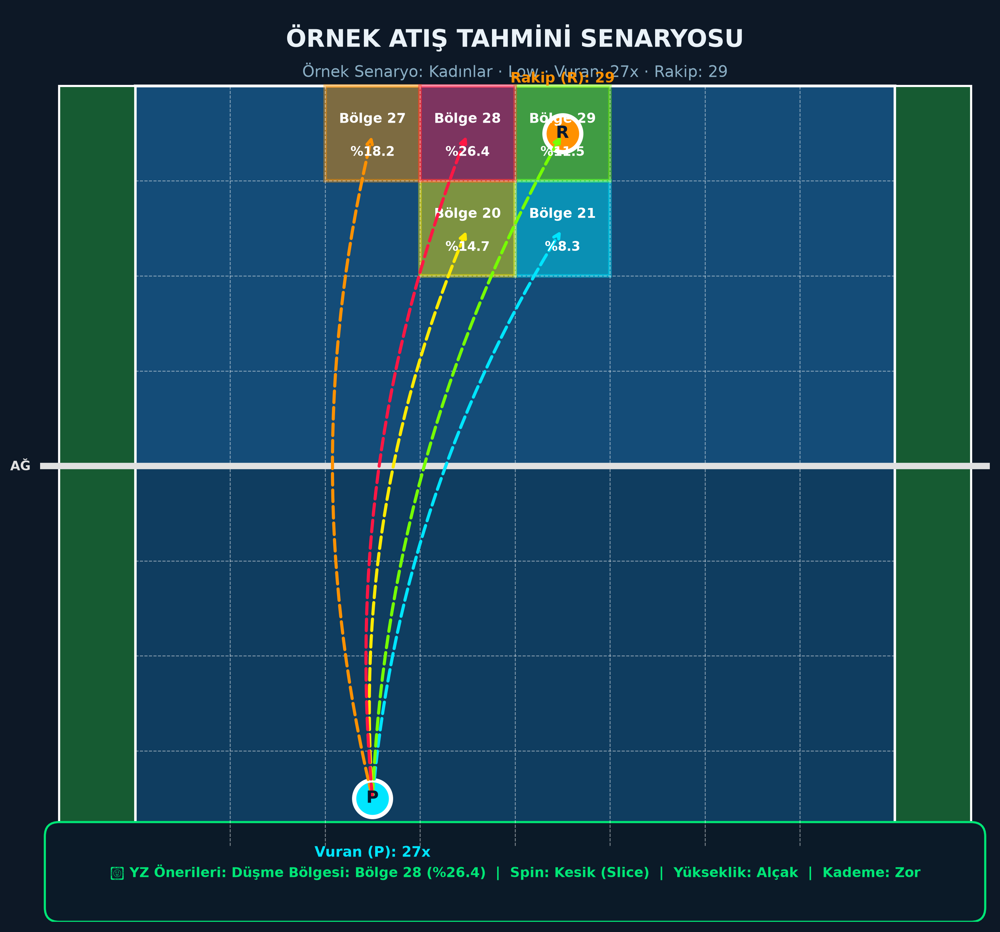
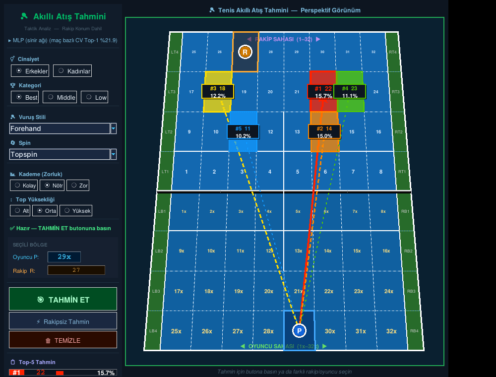
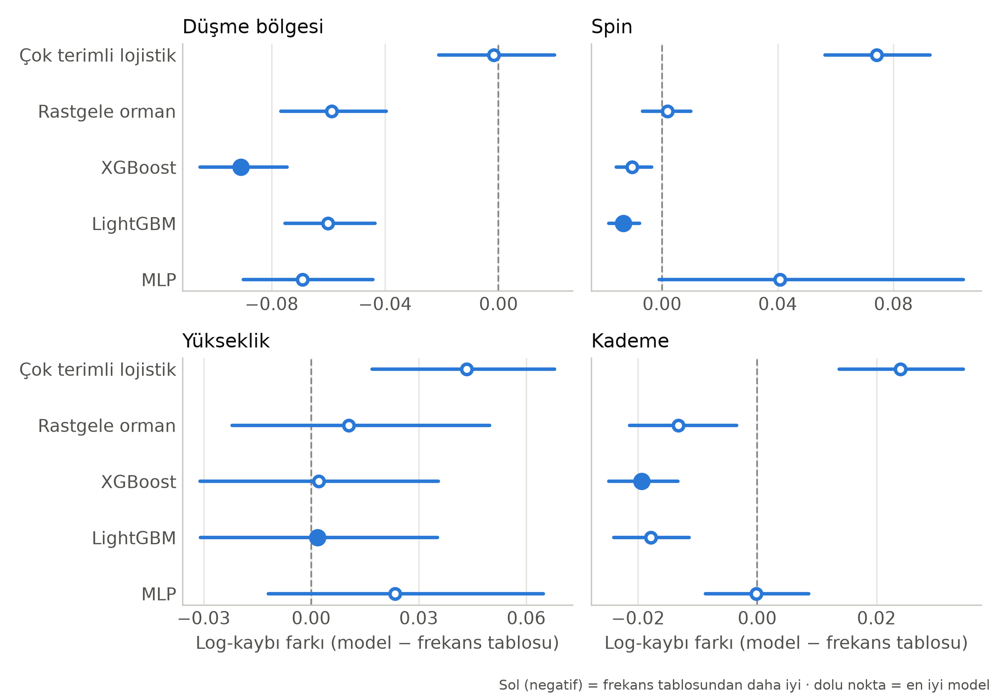
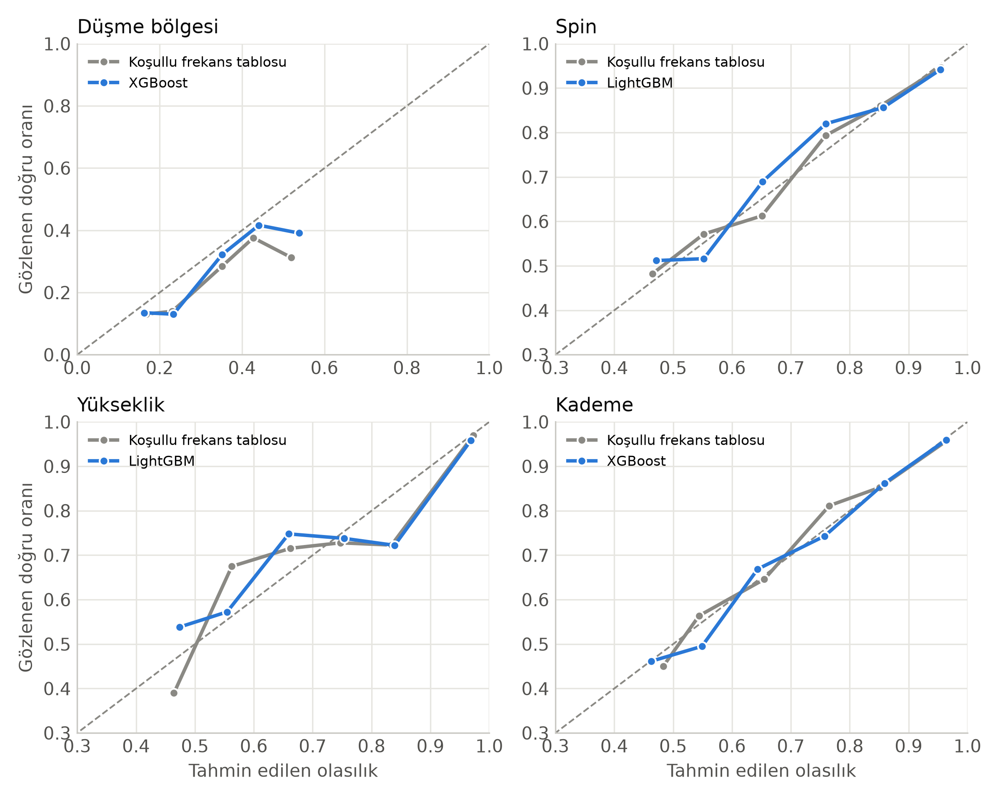

# 🎾 Tennis AI & Smart Ball Machine Prediction System

[](https://www.python.org/downloads/)
[](https://opensource.org/licenses/MIT)
[](https://scikit-learn.org/)
[](https://xgboost.readthedocs.io/)
[](https://lightgbm.readthedocs.io/)

[📖 Türkçe Dokümantasyon (README.md)](README.md)

---

## 📌 Executive Summary

This repository presents an end-to-end **Artificial Intelligence and Machine Learning framework for Tennis Shot Placement Prediction and Smart Ball Launching Machines**.

By leveraging shot-level tracking data from 19 professional matches (**11,724 successful shots**), the system predicts **where the ball will land, what spin will be applied, the trajectory height, and the shot difficulty/rank**, conditioned strictly on pre-shot context: **striker position, opponent position, gender, and competition tier**.

### Key Scientific and Engineering Innovations:
1. **Striker-Centric Canonical Invariance:**
   Eliminates target space duplication and half-guessing by rotating the coordinate frame 180° when the striker is in the upper half. Reduces noisy 51-class target spaces into **18 high-density canonical tactical cells** (3 depths × 6 columns) and 9 coarse regions.
2. **Leakage-Free Match-Based Cross Validation:**
   Uses `GroupKFold` across matches (19 independent groups) to prevent rally-level autocorrelation and unrealistic optimistic performance estimates.
3. **Smart Ball Machine Architecture (4 Inputs → 4 Outputs):**
   Removes post-shot stroke style from input features. Models landing zone, spin (Topspin, Slice, Flat), height (Low, Medium, High), and difficulty (Easy, Neutral, Hard) concurrently across 5 machine learning models.
4. **Instant Precomputed Inference Engine (`onhesap.json` - 2.7 MB):**
   Precomputes all 4,356 feasible state space combinations across all 5 models and 4 outputs. Enables sub-10ms response times on low-power edge hardware (Raspberry Pi, tablets) without requiring ML libraries (pure standard library Python).

---

## 🏟 Court Geometry & Architecture Visuals

### 1. Tennis Court Grid Architecture (32 + 32 Zones & Doubles Alleys)
The court is partitioned based on standard tennis dimensions (8.23 m singles width, 11.89 m half-court depth):
* **Opponent Half (Upper):** Zones `1` to `32` (8 columns × 4 depth tiers).
* **Striker Half (Lower):** Zones `1x` to `32x` (8 columns × 4 depth tiers).
* **Doubles Alleys:** `LT1-4`, `RT1-4` (Upper) and `LB1-4`, `RB1-4` (Lower).



---

### 2. Canonical Transformation: 51 Chaotic Targets → 18 Canonical Cells
Conventional approaches force the classifier to distinguish between 51 zones, wasting model capacity on figuring out which court half the shot lands in. Our canonical transformation achieves perspective invariance:



---

### 3. Smart Ball Machine Pipeline (4 Inputs → 5 Models → 4 Outputs)


---

### 4. Sample Tactical Prediction Scenario
Example scenario for Women's division, Low tier, Striker at `27x` (deuce corner), Opponent at `29` (ad corner):



---

### 5. Desktop Application Graphical User Interface (GUI)
Interactive Tkinter desktop GUI featuring Australian Open hardcourt aesthetics and real-time canvas overlays:



---

## 📂 Source Code Structure & Module Tour

```text
tenis_atis_sistemi/
├── tenis/                          # Core Python Package
│   ├── ayarlar.py                  # Global constants, court geometry metrics, stroke mappings
│   ├── bolgeler.py                 # Coordinate parser, canonical transformations & distance metrics
│   ├── veri.py                     # SQLite loader, clean preprocessing, zero-leakage target filter
│   ├── ozellikler.py               # Unified feature engineering for training & real-time inference
│   ├── modeller.py                 # Registry: Baselines, LR, Random Forest, XGBoost, LightGBM, MLP
│   ├── metrikler.py                # Top-k, Wilson CI, McNemar+Holm, match-based Wilcoxon tests
│   ├── atis_modeli.py              # 4-input -> 4-output ball machine engine & metrics
│   ├── onhesap.py                  # Fast JSON table reader & natural language CLI parser
│   └── tahmin.py                   # TenisTahminci object-oriented inference wrapper
├── 01_veri_raporu.py               # Step 1: Data sanity audit & exploratory distributions
├── 02_egit_degerlendir.py          # Step 2: Match-based 5-fold CV, ablation study & model export
├── 03_tahmin_ornek.py              # Step 3: Fast inference examples
├── 04_atis_modeli_egit.py          # Step 4: Full training of 4-output model & JSON precalculation
├── 05_konsol_tahmin.py             # Step 5: Interactive headless console prediction tool
├── 06_bes_model_karsilastirma.py   # Step 6: Academic benchmark, 2000 bootstrap iterations & plots
├── gui.py                          # Full-feature 24-stroke tactical analysis GUI
├── gui_atis.py                     # Smart ball machine GUI with concurrent CLI thread listener
├── generate_court_visuals.py       # Matplotlib script producing all high-resolution court graphics
├── veri/veritabani2.db             # Clean SQLite tracking database (11,724 successful shots)
└── cikti/                          # Precomputed tables, models and academic CSV outputs
```

---

## 📊 Empirical Evaluation & Benchmark Results

Evaluated across 19 independent matches via 5-Fold Match-Stratified Group Cross-Validation:

### Table 5: Landing Zone Prediction Benchmark (18 Classes)
| Model | Multi-Class Log-Loss (95% CI) | Brier Score | ECE | Top-1 Accuracy (%) | Top-3 Accuracy (%) | Coarse 9-Zone (%) | Mean Dist. Error (m) |
|---|---|---|---|---|---|---|---|
| **Majority Baseline** | 2.684 (2.647–2.721) | 0.901 | 0.000 | 9.9% | 27.9% | 18.0% | 2.98 m |
| **Conditional Frequency Table** | 2.395 (2.365–2.427) | 0.842 | 0.052 | 18.6% | 47.8% | 31.0% | 2.39 m |
| **Multinomial Logistic Regression** | 2.404 (2.378–2.431) | 0.841 | 0.038 | 18.3% | 47.7% | 30.4% | 2.38 m |
| **Random Forest (300 Trees)** | 2.339 (2.316–2.361) | 0.830 | 0.043 | 18.8% | 49.4% | 31.4% | 2.34 m |
| **XGBoost (Best Overall)** | **2.304 (2.281–2.327)** | **0.824** | 0.036 | **19.6%** | **50.5%** | **32.8%** | **2.24 m** |
| **LightGBM** | 2.312 (2.289–2.336) | 0.825 | **0.024** | 19.5% | 50.4% | 32.7% | 2.26 m |
| **MLP Neural Network** | 2.347 (2.325–2.369) | 0.832 | 0.037 | 18.9% | 49.0% | 31.3% | 2.33 m |

* XGBoost demonstrates statistically significant superiority in log-loss over the empirical frequency table and all competing algorithms (Wilcoxon signed-rank test with Holm correction, $p < 0.001$, winning 19 out of 19 matches).

---

### Table 6: Spin, Height, and Tactical Difficulty Prediction
| Output Target | Best Algorithm | Best Log-Loss | Frequency Baseline Log-Loss | Best Top-1 | Baseline Top-1 | Statistical Significance |
|---|---|---|---|---|---|---|
| **Spin Type (3 Classes)** | LightGBM | **0.372** | 0.386 | **87.9%** | 87.5% | Significant (17/19 matches, $p = 0.016$) |
| **Ball Height (3 Classes)** | LightGBM | **0.647** | 0.646 | **76.7%** | 76.7% | **Not Significant** ($p = 0.93$) |
| **Difficulty Rank (3 Classes)** | XGBoost | **0.266** | 0.285 | **91.3%** | 91.2% | Significant (18/19 matches, $p = 0.002$) |

> **Key Analytical Insight:** For ball height, advanced ML models provide no measurable gain over empirical conditional frequencies. For spin and difficulty, high accuracy is largely driven by models recognizing serve mechanics from player positioning.

---

### Benchmark Figures

#### Figure 4: Paired Log-Loss Differences vs. Empirical Frequency Baseline (95% Bootstrap CI)


#### Figure 5: Reliability Curves & Empirical Probability Calibration


---

## ⚡ Zero-Overhead Precomputation Engine

Edge deployment in sports robotics requires instant turnaround:
* All $2 \times 2 \times 33 \times 33 = 4,356$ tactical permutations are pre-evaluated.
* Model probabilities are quantized to integer basis points ($10^{-4}$) in `cikti/onhesap.json` (2.7 MB).
* Runtime footprint is below 10 MB RAM; zero compiled C-extension requirements.

---

## 🚀 Installation & Quickstart

```bash
# Clone the repository
git clone https://github.com/purkusur-pixel/tenis-yapay-zeka.git
cd tenis-yapay-zeka

# Install dependencies
pip install -r requirements.txt

# Launch the Smart Ball Machine Desktop Application
python gui_atis.py

# Or query directly from terminal
python 05_konsol_tahmin.py kadin low 27x 29
```

---

## 💻 Live Console Control (Concurrent Thread)

While `gui_atis.py` is running, enter commands directly into your terminal:

```text
komut> kadin low 27x 29          # Select all parameters in one command
komut> rakip=31                  # Update opponent position only
komut> vuran=disari              # Striker is outside the court baseline
komut> model=xgb                 # Switch model (lr, rf, xgb, lgbm, mlp, oto)
komut> durum                     # Print active configuration
komut> temizle                   # Reset positions
komut> yardim                    # Show command reference
komut> cikis                     # Terminate application
```

---

## 🏛 Funding & Citation

<p align="center">
  
  &nbsp;&nbsp;&nbsp;&nbsp;&nbsp;&nbsp;
  
</p>

<p align="center">
  <b>Trabzon Üniversitesi Spor Bilimleri Fakültesi</b><br />
  <b>Trabzon Üniversitesi Sporda Performans Değerlendirme ve Yetenek Seçimi Uygulama ve Araştırma Merkezi</b>
</p>

Bu çalışma, Türkiye Bilimsel ve Teknolojik Araştırma Kurumu (TÜBİTAK) tarafından 1001 Programı – Spor Araştırmaları kapsamında desteklenen 124M890 numaralı "Tenis için Yapay Zekâ Destekli Top Atma Makinesi Üretimi" başlıklı proje kapsamında gerçekleştirilmiştir.

This study was supported by the Scientific and Technological Research Council of Türkiye (TÜBİTAK) under the 1001 Programme – Sports Research (Project No: 124M890) within the scope of the project titled "Production of an Artificial Intelligence-Assisted Ball-Throwing Machine for Tennis".

**Principal Investigator:** Prof. Dr. Serdar Alemdağ  
**Software Developer:** Hüsnü Canbolat (husnucanbolat@trabzon.edu.tr)  
**Dataset:** 19 professional tennis matches, 11,724 successful shots.  
**License:** MIT License — see the [LICENSE](LICENSE) file for details.

If you use this work in your academic or industrial projects, please cite this repository.
